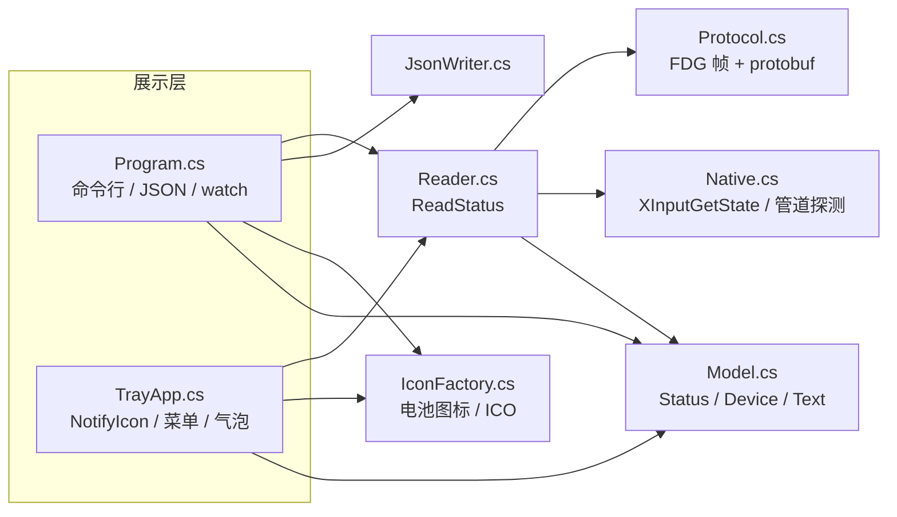

# 架构

## 总览

同一份 C# 源码用 `csc.exe` 编译两次：

- 不定义 `TRAY` → `flydigi_battery.exe`，控制台子系统；
- 定义 `TRAY` → `flydigi_battery_tray.exe`，WinForms GUI 子系统（`/target:winexe`，无控制台窗口）。

命令行与托盘共用读取、格式化、图标与自检代码，只有入口和展示层不同。



## 模块职责

| 文件 | 行数 | 职责 |
|---|---:|---|
| `src/Program.cs` | 409 | 参数解析、命令行入口、`--watch` 循环、预览/ICO 导出、自启动开关、托盘入口（`TRAY`） |
| `src/TrayApp.cs` | 458 | 托盘生命周期、后台采样线程、菜单、气泡、图标缓存、设置持久化、HKCU 自启动 |
| `src/Reader.cs` | 263 | 读一次完整状态：管道优先，失败时 XInput 只查连接；错误信息本地化 |
| `src/Protocol.cs` | 178 | `FDG_PROTOCOL` / `FDG_CHUNK` / `FDG_COMPRESSED` 帧读写，protobuf 基础类型读取 |
| `src/Model.cs` | 163 | `Device` / `Status` 模型，档位文字、百分比换算、连接方式、充电推断、详情文本 |
| `src/IconFactory.cs` | 539 | 16×16 设计栅格绘制电池、两位百分比点阵、充电/未知/未连接态，PNG 预览表与 ICO 编码 |
| `src/SelfTest.cs` | 302 | 不依赖手柄的回归自检：文字、颜色、填充、图标文字、提示文案、45 张图标、ICO、真实读取、JSON |
| `src/JsonWriter.cs` | 113 | 手写 JSON 序列化，避免第三方依赖 |
| `src/Native.cs` | 123 | 动态加载 `xinput1_4/1_3/9_1_0`，仅暴露 `XInputGetState`；`WaitNamedPipeW` 零等待探测 |
| `src/AssemblyInfo.cs` | 12 | 版本 `2.0.1.0`、产品名 |

合计 2,560 行。`tools/` 是逆向阶段的探针，不参与编译。

## 一次读取的数据流

1. `Reader.ReadStatus(source, pipeTimeoutMs, debug)` 校验 `source` 只能是 `auto|pipe`。
2. `PipeAvailability.HasAvailableInstance` 用 `WaitNamedPipeW(..., 0)` **零等待**探测管道实例。没有实例时直接记错误，不进入 `Connect` 超时。
3. 有实例则 `NamedPipeClientStream.Connect(timeout)`，写入 5 字节请求 `08 81 20 1A 00`（`cmdId=4097 GetConnectedDevices`）。
4. `FdgProtocol.Read` 解析帧，`ProtoReader` 解析 `IpcResult`，取 `field 5` 的设备列表；`DeviceInfo` 取 `level`（field 9）等字段。
5. 成功且设备数 > 0：
   - `Source = "飞智后台服务（与空间站界面同源，7 档）"`
   - `Ok = true`、`Connected = true`、`ConnectionSource = "pipe"`
   - 每个设备 `Text.Fill` 补齐 `levelText`、`percent`、`approx`、`connect`、`charging`、`plugged`。
   - **不再调用 XInput。**
6. 管道失败或设备列表为空：
   - `TryGetConnectedSlot` 遍历 slot 0–3 调 `XInputGetState`，只判断是否连接。
   - 有手柄：`Ok=false`、`Connected=true`、`ConnectionSource="xinput"`，错误文案说明 7 档不可用。
   - 无手柄：`Ok=false`、`Connected=false`、`ConnectionSource=null`。
7. 写入 `Timestamp` 与 `Timing`（`pipe=...ms xinput-check=...ms total=...ms`）。

## 状态模型

```csharp
Status {
  bool Ok;                  // 是否拿到 7 档电量
  bool Connected;           // 是否有手柄（管道设备或 XInputGetState）
  string ConnectionSource;  // "pipe" | "xinput" | null
  string Error;             // 失败原因
  string Source;            // 数据源名称，无电量为空
  DateTime Timestamp;
  List<Device> Devices;
  string Timing;
}
```

`ok` 与 `connected` 是**正交**的：`ok=false, connected=true` 表示“手柄在，但电量读不到”，这是最关键的一个状态，UI 必须区分它和“未连接”。

`Device` 关键字段：`ProductName`、`DeviceCode`、`Uid`、`Category`、`ConnectType`、`Level`、`LevelMax=6`、`Percent`、`LevelText`、`Approx`、`Connect`、`Charging`、`Plugged`。JSON 细节见 [命令行与 JSON](cli-and-json.md)。

## 线程模型

### 命令行

单线程顺序执行。`--watch` 是 `while(true)` + `Thread.Sleep`，每次重新读管道（管道连接不常驻）。

### 托盘

| 线程 | 职责 |
|---|---|
| UI 线程（STA） | 创建 `NotifyIcon`、菜单、隐藏的 `Form`；只做换图标/换文本/弹气泡 |
| `flydigi-sampler`（后台） | 循环调用 `Reader.ReadStatus`，通过隐藏 `Form.BeginInvoke` 把结果投递给 UI |

- 启动后立即采样一次，之后按 `IntervalSec`（最小 5 秒）等待；`AutoResetEvent` 支持“立即刷新”打断等待。
- `IconKey = size:level:levelMax:plugged`；未拿到电量时是 `size:connected` 或 `size:none`。同一 key 复用已创建的 `Icon`，不重复绘制。
- 单位例：命名互斥体 `Local\FlydigiBatteryTray`，与 PS1 托盘共用；第二个实例直接返回 0。
- 退出：`_stop=true`、唤醒线程、`Join(1500)`，释放图标与菜单。

托盘只使用“第一个设备”（`Devices[0]`）驱动图标，多设备时其余仅在命令行/JSON 中可见。

## 设置与自启动

- 设置存 `HKCU\Software\FlydigiBattery\Tray`：`IntervalSec`（5–3600）、`Source`（只接受 `auto|pipe`，旧的 `xinput` 自动回落到 `auto`）。
- 菜单选项为 10 / 20 / 60 秒，默认 20。
- 自启动写 `HKCU\Software\Microsoft\Windows\CurrentVersion\Run`，值名 `FlydigiBatteryTray`，指向托盘 exe。
- 用命令行 exe 执行 `--install` 时，会自动指向同目录的 `flydigi_battery_tray.exe`。
- 托盘启动时 `HealPath()`：若 exe 被移动导致注册表路径不一致，自动改写。
- 会删除旧版 PowerShell 版留下的启动项快捷方式 `flydigi-battery-tray.lnk`，避免双开。

## 设计约束

- **单文件、零依赖**：只引用 `System.dll`、`System.Core.dll`、`System.Drawing.dll`、`System.Windows.Forms.dll`，全部随 .NET Framework 提供。
- **C# 5 语法**：`csc.exe` 是 .NET Framework 4.x 自带版本，代码限制在 C# 5，不使用字符串插值、null 条件运算符等 C# 6+ 语法。
- **不引入 XInput 电量**：`XINPUT_BATTERY_INFORMATION` 与 PnP 枚举已删除。原因见 [管道协议](protocol.md#为什么不再使用-xinput-电量)。
- **不常驻管道连接**：每次采样新建连接，避免与空间站 App 抢占单客户端实例，也避免服务端 worker 状态残留。
- **PS1 与 C# 行为对齐**：两套实现的数据通道、文案、颜色、填充规则一致（JSON 字段名有差异）；修改时必须同步，见 [PowerShell 参考版](ps1-reference.md)。
